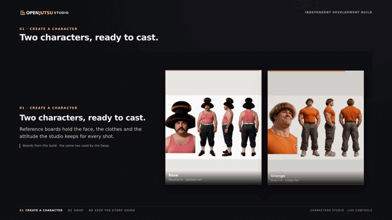
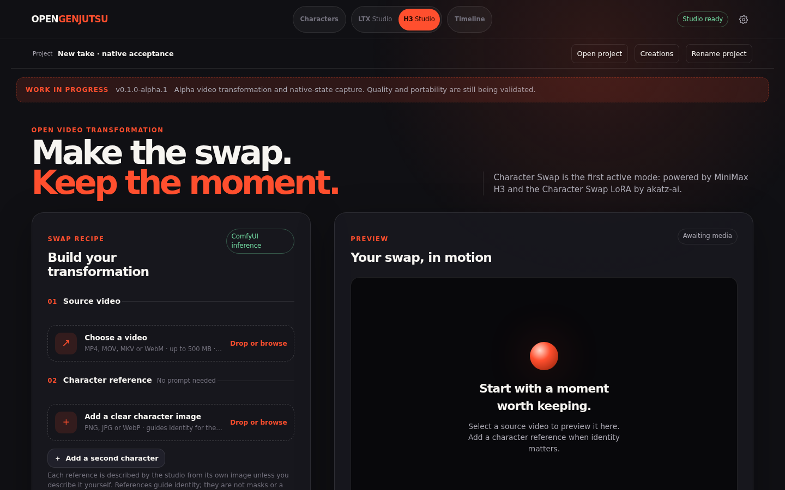

# Open Jutsu Studio

## Create. Swap. Continue. Share.

**An open-source video studio for putting your characters into footage—and keeping a take you can return to.**

Create a character or bring your own reference. Swap the cast of a clip, reopen
an H3 take to continue the story, then share a vertical comparison Reel.

**Local-first · Your GPU, your footage · [Apache-2.0](LICENSE)**

[Install](#install) · [Creative loop](#the-creative-loop) · [Roadmap](ROADMAP.md) · [Documentation](docs/README.md)

<p align="center"></p>

*Recorded in the running application on 30 October 2026: the two reference boards,
a real Swap result, then one continuous clip — the end of a Take followed by the
continuation it produced. Nothing here is a mock-up.*



*The same studio, empty: an interface capture, not a generated-result quality claim.*

## Quickstart

```bash
git clone https://github.com/lvsas/OpenJutsuStudio
cd OpenJutsuStudio
make install     # Python 3.12 + FFmpeg + .venv + the local SDK proxy
make check       # prints exactly what your ComfyUI is missing, exit 1 if anything is
make run         # starts the proxy and the studio together on 127.0.0.1:8000
```

`make run` starts the SDK proxy in the right order and stops it again on Ctrl+C,
so there is only ever one command to remember.

On Windows there is no `make`: run `python scripts/launch.py` instead. It does the
same thing in Python — finds `.venv`, starts the proxy, waits for it, then serves
the studio — so the install is native on Windows, macOS and Linux, with no WSL. If you already run an SDK v2
endpoint, set `OPENGENJUTSU_COMFY_BASE_URL` and skip the proxy entirely.

`check_dependencies.py` is the honest gate: it walks the node classes and model
files the selected engines need and prints what the executor is missing, before
any generation is attempted. It exits non-zero, so it can run in CI or gate a
deployment.

**What it costs to run:** about 24 GB of VRAM, your own ComfyUI, no account and
no credits. `make check` names the exact node or weight that is missing instead of
failing mid-generation.

The local proxy is not decoration: the application speaks the Comfy **SDK v2**
API, a stock ComfyUI serves v1, and a loopback process translates between them.
If you already run an SDK v2 endpoint, point `OPENGENJUTSU_COMFY_BASE_URL` at it
and the proxy disappears from the picture.

## The creative loop

1. **Create or bring a character.** Open Characters (`/characters`) to generate
   with FLUX 3 Klein, or use your own reference image.
2. **Swap the cast.** In LTX Studio (`/`) or H3 Studio (`/h3`), add footage and
   one or two ordered references, then preview the result.
3. **Continue the take.** Every new H3 Swap automatically retains its continuation state.
   Open that take in Timeline (`/timeline`) and create a continuation.
4. **Share the moment.** Preview and download a vertical before/after Reel.
   Native file sharing depends on browser support; download is the fallback.
   Sharing does not automatically publish to social platforms.

### A take is more than an MP4

The H3 path retains the **MP4 + MCTX + COND** family, references, frozen
recipe and parent lineage. Open Jutsu Studio connects native-file publication through
the SDK, reopening and continuation in one workspace. A recipe records the render;
**JSON alone is not the native state needed to continue it**. A social Reel is
not a complete native backup. Upstream engines define the state formats: H3 and
LTX state is not interchangeable.

## Current boundaries

- **New H3 Swaps and re-runs always retain native state.** Missing state publication
  fails explicitly; an existing MP4 alone cannot recreate missing MCTX/COND files.
- **LTX native continuation is not delivered.** Timeline forward continuation is
  experimental and engine-specific, not a promise that every editing mode works.
- **Character/library handoffs exist.** End-to-end browser acceptance and clearer
  navigation are ongoing work; new recipe experiments need saved-Capsule compatibility.
- Render completion does not guarantee identity, selective editing, motion or sound
  quality. Live Cloud execution and broad cross-target portability are not verified.

[Roadmap](ROADMAP.md) · [Workflow and evidence boundaries](docs/README.md)

## Requirements

- Version **v0.1.0-alpha.1**, development preview, grounded in `src/app_release.py`.
- Git/Bash, **uv**, **Python 3.12**, and **FFmpeg/ffprobe** on `PATH`.
- A separately prepared GPU **ComfyUI** executor with the chosen engine's custom
  nodes and model weights. **24 GB VRAM is recommended**, not a fit guarantee.
- Official **Comfy SDK 0.5.x** transport; the local setup uses an API-v2 proxy.

See [executor setup](docs/executor-setup.md) for engine-specific prerequisites,
[dependencies](docs/dependencies.md) for file roles, and
[weight installation](docs/local-setup.md#prepare-fixed-swap-weights) for the explicit downloader.
No model weights ship in this repository. There is no Docker installation in this preview.

## Install

Repository access may require your own authorized GitHub account.

```bash
# Install uv and FFmpeg first: see docs/local-setup.md
git clone https://github.com/lvsas/OpenJutsuStudio.git
cd OpenJutsuStudio
bash scripts/setup.sh --with-proxy
```

`bash scripts/setup.sh` installs only the app dependencies. The separate
`--with-proxy` flag explicitly opts into installing the local proxy; setup never
starts services, installs ComfyUI/custom nodes, or downloads model weights.

Start your prepared ComfyUI instance, then run the proxy in one terminal:

```bash
# Upstream ComfyUI; override this for a trusted remote server.
export COMFYUI_URL=http://127.0.0.1:8188
env -u PYTHONPATH .venv/bin/comfy-api-proxy run \
  --comfyui "$COMFYUI_URL" --host 127.0.0.1 --port 8189
```

In a second terminal, from the repository root:

```bash
# The launcher pins the SDK to this local proxy by default.
bash scripts/run_app.sh
```

Open <http://127.0.0.1:8000>. App and proxy bind to loopback only. The launcher
requires Python 3.12 and clears inherited `PYTHONPATH`.

Open **Settings** (`/settings`) to test and save the API-v2 target, write-only API
key and compatible target-specific LTX/H3 Swap model filenames. Test/Save do not
submit generation. Connection success alone does not establish engine readiness;
see [local setup and troubleshooting](docs/local-setup.md).

## Documentation

[Setup and troubleshooting](docs/local-setup.md) · [Executor preparation](docs/executor-setup.md) ·
[Dependencies](docs/dependencies.md) · [Workflows](workflows/README.md) ·
[Documentation](docs/README.md) · [Roadmap](ROADMAP.md)

## Built on / credits

An independent open-source video studio, built for the
[Open Source Higgsfield Competition](https://comfy.org/open-source-higgsfield) as
an answer to the character-swap idea — not affiliated with, endorsed by, or
connected to Higgsfield. It ships connected Character and Timeline workspaces,
built with **ComfyUI** and the
[Comfy Developer Platform](https://comfy.org/platform), using official Comfy SDK
transport for self-hosted execution.

- **Black Forest Labs** — FLUX 3 Klein for Characters; FLUX 2 Klein for LTX anchors.
- **Lightricks / Ripple** — LTX 2.5 and the Ripple FFAF IC-LoRA motion path.
- **MiniMax / akatz-ai** — H3 and the `h3_character_swap_v1.5` Character Swap LoRA.
- **ComfyUI and extension authors** — execution, state mechanisms and node packs;
  see [sources and dependencies](docs/dependencies.md).
- **Open Jutsu Studio** — the connected studio and continuity-file publication/reopening nodes.

Prepared for the [Open Source Higgsfield Competition](https://comfy.org/open-source-higgsfield).
Entirely local execution is allowed. A deployed try-it link is optional.
The innovation category includes novel custom node packs. Combined techniques:
FLUX character/reference editing, LTX + Ripple propagation, H3 Swap/native continuation,
SDK artifact transport and local FFmpeg Reel assembly.

## Contributing

See [CONTRIBUTING.md](CONTRIBUTING.md) for GPU-free checks and contribution boundaries.
Report reproducible steps and sanitized diagnostics, not API keys or private native backups.

## License

Application code: **Apache-2.0**, see [LICENSE](LICENSE). Model weights and third-party
extensions have separate terms; obtain any required permissions before commercial
use or redistribution. See [component licences](docs/model-licences.md).
