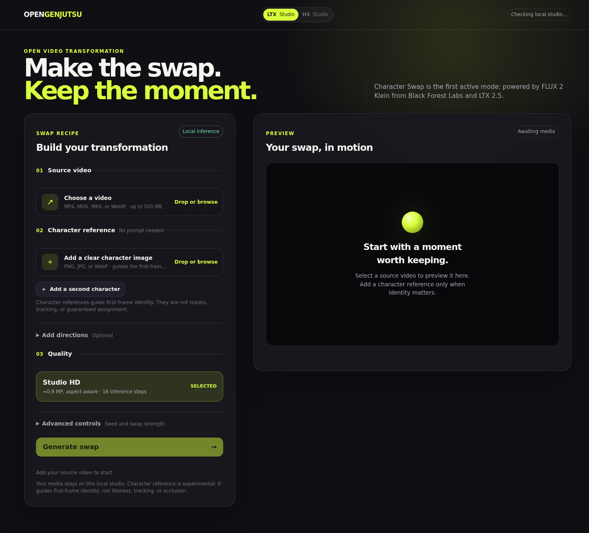
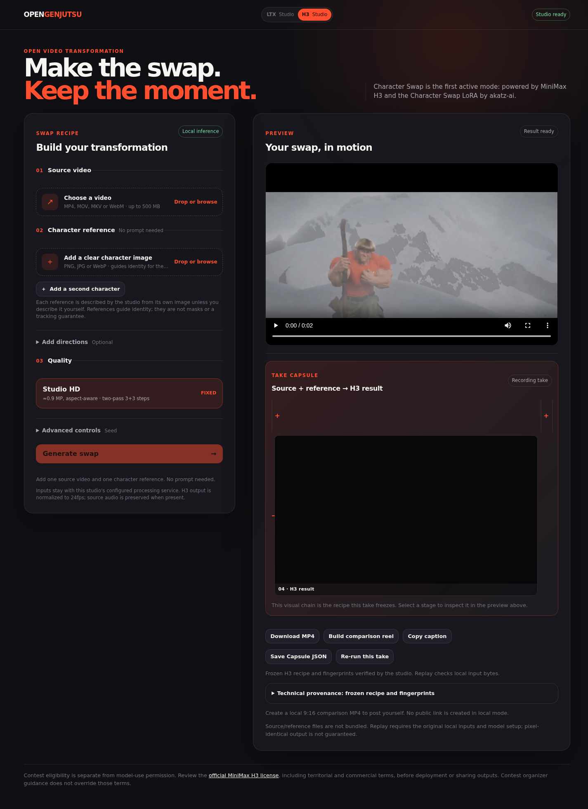

# OpenGenjutsu — Open-Source Reality Manipulation for Video

**An open-source rebuild of [Higgsfield Genjutsu](https://higgsfield.ai/genjutsu) on the [Comfy Developer Platform](https://comfy.org/platform).**

Genjutsu is a paid feature that transforms footage you already shot — no reshoot.
This project rebuilds it in the open, on top of open-weight models.

Built for the **Open Source Higgsfield Competition** (ComfyUI · NVIDIA · Runpod).

---

## What it does

You bring footage you already shot and a character reference; the studio returns the same
moment with a different character in it, and a **take capsule** that records exactly what was
consumed so the take can be inspected, exported or re-run.

Two studios share one pipeline, one interface language and one capsule:

| Studio | Chain | State |
| --- | --- | --- |
| **LTX Studio** | source + reference(s) → FLUX 2 Klein first-frame edit → LTX 2.5 + Ripple propagation | working |
| **H3 Studio** | source + 1–2 ordered character references → MiniMax H3 two-pass character swap at 0.9 MP | working |



*LTX Studio: the source and the character references are chosen with the same picker both
studios use, and the take capsule records what the render consumed.*



*H3 Studio with two ordered character references and a completed take. The capsule chain
shows one card per reference, and every description the studio wrote is frozen in the take
alongside its provenance — `user` when you typed it, `generated` when the local vision model
read it from your image.*

Type nothing at all and the studio still works: it reads the clip to name what must stay
unchanged, reads each reference image to name the replacement character, writes both into a
frozen prompt and renders. You can override any of it; nothing is ever invented silently.


## Competition requirements, met

| Requirement | Where |
| --- | --- |
| Built on the **Comfy Developer Platform** (Comfy Router and/or Comfy SDK) | every graph is submitted through the official `comfy_sdk`; the local proxy bridges that API to a self-hosted ComfyUI, and an authenticated deployment target is supported |
| Open-source licence and enough setup detail to run it elsewhere | [Apache-2.0](LICENSE), [local setup guide](docs/local-setup.md), `bash scripts/setup.sh --with-proxy` |
| Workflow files | [`workflows/`](workflows/README.md) — the exported API-format graphs, held in step with the code that runs by a test |
| Other tools, models and techniques explained in the demo video | listed under *Techniques the demo explains* below |
| Lawful, SFW, no unlicensed IP or likenesses | model weights and fixtures are user-supplied; nothing copyrighted is bundled |
| One submission per person | ✔ |


## Techniques the demo explains

The competition requires the combined techniques to be explained in the demo video:

- **Comfy SDK** for every submission, plus the `comfy-api-proxy` bridge to self-hosted ComfyUI
- **FLUX 2 Klein** (Black Forest Labs) as the first-frame image editor in LTX Studio
- **LTX 2.5 + Ripple FFAF IC-LoRA** as the motion stage in LTX Studio
- **MiniMax H3**, two-pass sampling, with the **Character Swap LoRA `h3_character_swap_v1.5` by akatz-ai** in H3 Studio
- a **local vision model** (`Qwen3-VL-4B`) that reads the source clip and each reference image to write the descriptions the studio freezes into the take


## Current MVP: Character Recast with LTX 2.5 + Ripple

The first working product path is a local-first **visible-character recast**. Its first-frame editor is FLUX.2 Klein from **Black Forest Labs**; LTX 2.5 + Ripple carries that approved image edit through motion.

```
source video + character reference(s) + optional directions
        → edit frame 0 with FLUX.2 Klein image editing
        → propagate with LTX 2.5 + Ripple FFAF IC-LoRA
        → previewable edited video
```

The target is an open, local-first video transformation studio. **Character Recast is its first active mode**, not the whole product category: it uses optional reference images to guide the first-frame edit, then propagates it. We do not claim reliable object swap, wardrobe editing, motion transfer, or generic replacement until each has its own validated video path.


---

## Why LTX 2.5 + Ripple

LTX 2.5 + Ripple is an open-weight **First Frame All Frames (FFAF)** workflow: an image editor changes the first frame, then the Ripple IC-LoRA propagates the change through the source video's motion. This gives us an actionable control point and a fast local video stage. It is our documented implementation choice, not a statement about Genjutsu's private pipeline.

The LTX 2.5 components and Ripple adapter have separate model licenses/terms. Review them before redistribution or commercial use; this repository does not bundle model weights.


---

## Requirements

| | |
|---|---|
| ComfyUI | ≥ 0.40, with the LTXVideo, VideoHelperSuite and KJNodes packs used by the workflow |
| Comfy SDK | `comfy-sdk` 0.5.x |
| GPU | 24 GB VRAM recommended; a real two-shot app run completed on RTX 3090 (see validation limits below) |
| Python | 3.12 (setup creates a project-local `.venv` with `uv`) |
| FFmpeg | `ffmpeg` and `ffprobe` available on `PATH` |
| Local SDK proxy | `comfy-api-proxy` 0.1.6, installed only with `--with-proxy`; bridges the SDK v2 API to self-hosted ComfyUI |

The frame editor also requires FLUX.2 Klein 9B and its ComfyUI-compatible text encoder/VAE installed locally. Model downloads are user-managed and must follow each model's terms.


---

## Install

```bash
# Install uv and FFmpeg first: see docs/local-setup.md
git clone https://github.com/lvsas/Open-Source-Higgsfield-Competition.git
cd Open-Source-Higgsfield-Competition
bash scripts/setup.sh --with-proxy
```

`bash scripts/setup.sh` installs only the app dependencies. The separate
`--with-proxy` flag explicitly opts into installing the local proxy; setup never
starts services, installs ComfyUI/custom nodes, or downloads model weights.

Start your prepared ComfyUI instance, then run the proxy in one terminal:

```bash
# Upstream ComfyUI; override this for a trusted remote server.
export COMFYUI_URL=http://127.0.0.1:8188
env -u PYTHONPATH .venv/bin/comfy-api-proxy run \
  --comfyui "$COMFYUI_URL" --host 127.0.0.1 --port 8189
```

In a second terminal, from the repository root:

```bash
# The launcher pins the SDK to this local proxy by default.
bash scripts/run_app.sh
```

Open `http://127.0.0.1:8000`. Both services bind to loopback only. The launcher requires Python 3.12 and clears inherited `PYTHONPATH`.

`OPENGENJUTSU_COMFY_BASE_URL` is the **only** application target override. The default is the loopback self-hosted SDK proxy; an inherited `COMFY_BASE_URL` is deliberately overwritten to prevent accidental remote inference. Explicit Cloud/deployment targets require `COMFY_API_KEY` in the app process environment. Remote readiness branches are tested locally, not evidence of a live Cloud render. See the [local setup guide](docs/local-setup.md).


---

## Models

`env -u PYTHONPATH .venv/bin/python scripts/download_models.py --comfyui /path/to/ComfyUI` downloads the public LTX 2.5 + Ripple components into their ComfyUI folders; use `--dry-run` to inspect the targets first. Run this where the ComfyUI model directories are accessible; a remote HTTP endpoint alone is not a model installation path. The script does not bundle weights in this repository.

| File | Folder | Role |
|---|---|---|
| `ltx-2.5-22b-distilled-transformer-comfy-int8-convrot.safetensors` | `diffusion_models` | LTX 2.5 video model |
| `gemma4-12b-with-proj-ltx-2.5-comfy-int8-convrot.safetensors` | `text_encoders` | LTX text encoder |
| `ltx-2.5-video-vae-conv-bf16.safetensors` | `vae` | video VAE |
| `ltx-2.5-audio-vae-bf16.safetensors` | `vae` | audio VAE |
| `LTX25_Ripple_v11.safetensors` | `loras` | FFAF propagation adapter |

The image-edit stage additionally requires the ComfyUI-compatible FLUX.2 Klein 9B checkpoint, text encoder, and VAE named in `src/core.py`. Those editor files are not auto-downloaded by this script yet; install them through the relevant official/ComfyUI model source and review their license terms. The gated LTX in/outpainting IC-LoRA is **not** required by this Ripple-based MVP.


---

## Run the app

```bash
# Keep the proxy running in its own terminal (see Install).
bash scripts/run_app.sh
```

Then open `http://127.0.0.1:8000`, choose a source video and a character reference, and generate **without typing a prompt**. **Add directions** is collapsed by default and optional: open it to refine the recast or describe a text-only edit without a reference. A closed directions editor is excluded from submission. Reveal a second reference only when needed; person-mapping hints remain optional. The backend compiles a versioned reference-recast instruction for FLUX and keeps LTX's propagation instruction separate. Both effective prompts and the original optional brief are recorded for replay; see [prompt contracts](docs/architecture/prompt-profiles.md).

The Creative Studio previews local media, keeps the active job ID across reloads, translates real pipeline stages, and exposes a result MP4. Completed takes show **Source → FLUX anchor → Motion result**; the anchor is the actual image passed to Ripple, not a reconstructed video frame. Older takes without recorded anchors are labeled honestly. **Take Capsule** records the local recipe, cuts and asset SHA-256 fingerprints and supports linked local replay. It never bundles private media or promises pixel-identical output. Studio HD targets approximately 0.9 megapixels at the source aspect ratio with 16 Ripple steps. Ripple strength remains advanced; **1.35 is a validated starting point on a controlled single-subject fixture**, not a universal optimum.

Check `GET /api/readiness` before submitting a job. `GET /health` proves only that
the app process is alive; it does not validate the proxy, upstream, nodes or models.

### H3 Studio (experimental)

The engine switch now links to `/h3`. H3 is available by default but can be
administratively disabled with `OPENGENJUTSU_H3_STUDIO_ENABLED=0`. Its readiness
check is target-specific and blocks generation until the configured Comfy target
reports the H3 graph's nodes and models as available. It accepts one continuous
shot and one character reference, normalizes to 24 fps, derives a 32-aligned
render canvas from source aspect ratio (each input edge at most 512 px), and
upscales that canvas 2×. H3 weights and custom-node availability remain target
requirements; a successful self-hosted render does not prove Comfy Cloud support.
The Studio shows real queue/run states and preserves source audio when present.
See [H3 runtime validation](docs/validation/h3-studio-runtime.md) for tested
fixtures, measurements, known visual limits and the actual model license.

The CLI in `src/genjutsu.py` is a legacy LTX 2.3 prototype and is not the current app entry point.

---

## Documentation

- [Local setup and troubleshooting](docs/local-setup.md) — Python 3.12, FFmpeg, opt-in proxy, remote upstream and readiness
- [Workflow files](workflows/README.md) — the exported API-format graphs the app submits, and how their asset placeholders are substituted
- [Documentation index](docs/README.md) — the map of everything under `docs/`, with what is current and what is historical
- [Competition roadmap](docs/plans/competition-roadmap.md) — the requirements checklist, what is done, and the decisions still open
- [Creative Studio UI architecture](docs/ui-architecture.md) — product workflow, engine visual identity and honest local-sharing boundary
- [Reference intelligence plan](docs/plans/2026-10-16-reference-intelligence.md) — opt-in Qwen-VL preflight, review gate and target-visibility scope
- [Open Weights runtime evidence contract](docs/validation/open-weights-runtime-contract.md) — declared models/nodes/transport, live readiness gate and submission-proof boundaries
- [Competition UX/viral-readiness audit](docs/audits/2026-10-16-competition-ux-gap.md) — verified gap analysis and follow-up gates
- [`src/app.py`](src/app.py) — local UI, upload endpoint, job tracking and result route
- [`src/core.py`](src/core.py) — job persistence and per-shot pipeline orchestration
- [`src/take_capsule_api.py`](src/take_capsule_api.py) — path-free local recipe/provenance manifest and linked replay
- [`src/graphs.py`](src/graphs.py) — FLUX.2 Klein and LTX/Ripple API-format graphs
- [`src/comfy_transport.py`](src/comfy_transport.py) — official SDK target, execution and downloads
- [`src/segments.py`](src/segments.py) — per-shot asset transfer, padding and exact frame restoration
- [`scripts/download_models.py`](scripts/download_models.py) — idempotent LTX/Ripple weight setup
- [ComfyUI-LTXVideo](https://github.com/Lightricks/ComfyUI-LTXVideo)
- [ComfyUI-VideoHelperSuite](https://github.com/Kosinkadink/ComfyUI-VideoHelperSuite)
- [ComfyUI-KJNodes](https://github.com/kijai/ComfyUI-KJNodes)


---

## Character Reference Status

The Creative Studio accepts up to two optional PNG/JPEG/WebP character references in the main job form. It shows one calm primary control by default and discloses the second only when the user explicitly adds another visible character. Each reference can have an optional target hint; reference order is preserved through the job metadata and FLUX conditioning chain. Assets are stored with the job and transferred as Comfy assets for each shot. Unit and HTTP-contract tests cover this route.

This is visual conditioning, not a guaranteed reference-to-person assignment. In particular, a reference image does not solve an absent or occluded target; that requires a separately validated anchoring/tracking strategy.

## Upscale

The pipeline supports optional spatial upscaling (default 2x) via `upscale_video()`. Enable with `upscale: True` in job options. Uses ffmpeg lanczos scaling for quality.

## Architecture

```
src/
  app.py              — FastAPI upload, job and result routes
  core.py             — Comfy SDK pipeline (detect → edit → merge → upscale)
  static/
    design-system.css — engine-scoped visual tokens and reusable UI primitives
    app.css            — responsive Creative Studio layout
    app.js             — source preview, job states and local export actions
    reference-controls.js — progressive optional second-reference controls
    studio-utils.js    — shared browser helpers
  templates/index.html — English-first Creative Studio UI
  genjutsu.py     — Legacy LTX 2.3 CLI prototype (not current entry point)
tests/            — Unit and regression tests (unittest)
scripts/
  download_models.py — Idempotent LTX/Ripple weight setup
```

**Pipeline**: `detect_scenes()` → `edit_segment()` per shot → `merge_segments()` → `upscale_video()`

The launcher always ignores inherited `COMFY_BASE_URL`; the SDK target is local by default and may be changed only with the explicit `OPENGENJUTSU_COMFY_BASE_URL` setting for an explicitly selected Comfy target. This prevents an accidental ambient Cloud target from becoming an inference dependency.

The app has target-aware readiness for a local proxy, remote self-hosted proxy, Comfy Cloud and API v2 deployments. **Only the self-hosted path has live render evidence**; Cloud/deployment authentication branches have tests, but required nodes/models and real rendering must still be validated on the selected target. Queueing behind an existing Comfy job is allowed with an on-screen waiting notice. No specific server cache setting is required.

## Current Evidence

- A real two-shot run was submitted through the web form, processed by FLUX.2 Klein and LTX/Ripple, downloaded, and played through to the end in Chromium: 121 frames, 24 fps, 768×416. Shot padding is removed before assembly; the app restores source audio when present.
- **Visual quality is not validated:** the corrected run preserves the scene cut, but recolors/armors the tiger despite instructions to preserve it. Successful execution is not a successful selective edit or a contest-ready result.
- CPU tests are self-contained; they do not require the private development clip. They do not prove GPU quality, reference-image behavior on real footage, Cloud compatibility or licensing eligibility.
- The Creative Studio UI is implemented and browser-checked for desktop/mobile layout, source preview and HTTP/API integration. Local Download and Copy caption are real actions; **public social sharing is not implemented** because no hosted, recipient-accessible result URL exists.
- The public studio deliberately focuses on LTX and FLUX. Future studio modes are not named or advertised until they have a real backend and an end-to-end validation.

## Contributing

1. Fork the repository
2. Create a feature branch
3. Write tests first (TDD)
4. Run `env -u PYTHONPATH .venv/bin/python -m unittest discover -s tests -v`
5. Commit with descriptive messages
6. Open a PR

## License

Apache-2.0 — see [LICENSE](LICENSE).

This repository is Apache-2.0. LTX 2.5, Ripple, FLUX.2 Klein, experimental MiniMax H3 and all ComfyUI extensions retain their own licenses and acceptable-use terms; the app license does not license model weights. **Obtain any required commercial license before using models commercially.** H3 also has territorial restrictions: read the [official H3 license](https://huggingface.co/MiniMaxAI/MiniMax-H3/raw/main/LICENSE) and the [H3 scope note](docs/validation/h3-license-gate.md). Organizer guidance relayed by the user accepts locally downloadable/runnable models, including non-commercial models and H3, for contest eligibility; this is not permission for unrestricted commercial or territorial deployment. No weights are bundled.
